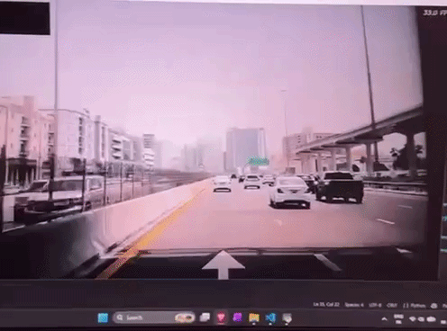
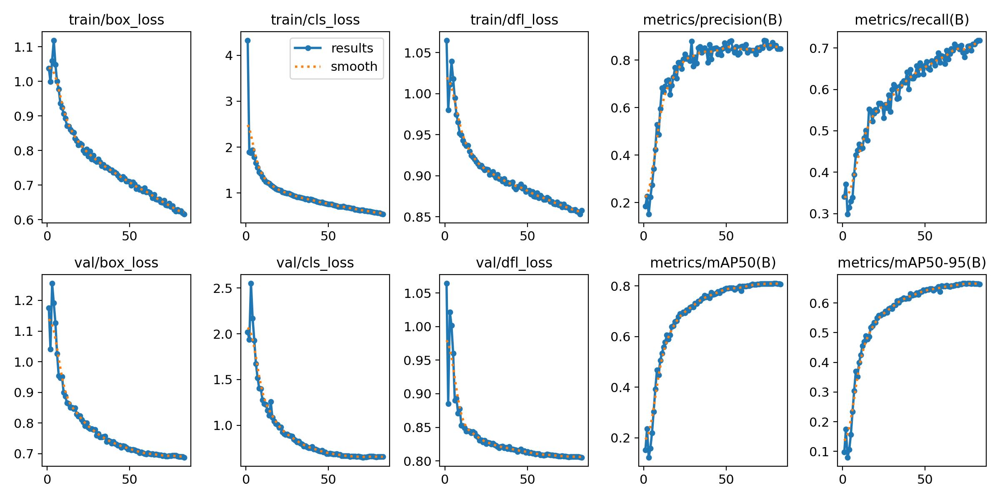
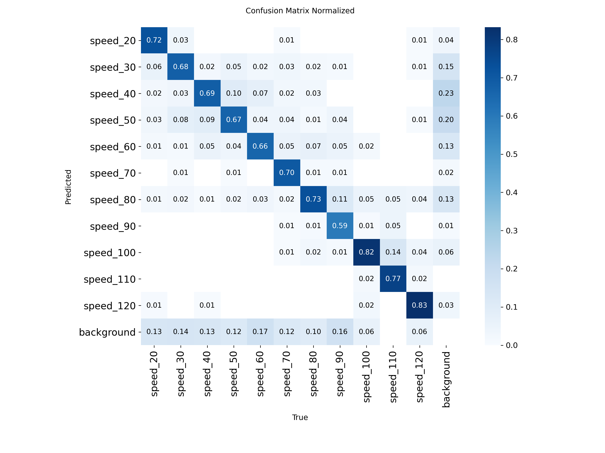
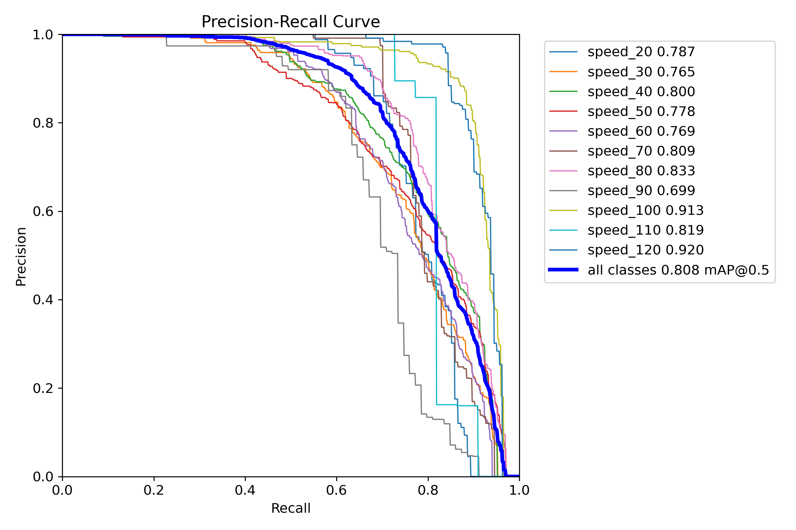
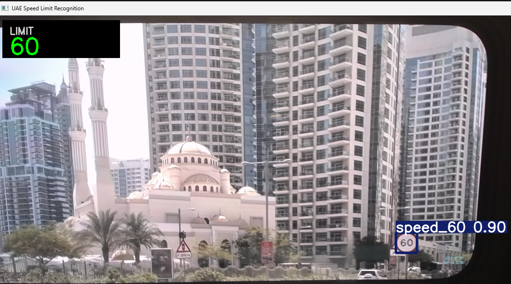

# UAE Speed Limit Recognition

A hobby project that reads speed limit signs from a webcam. I trained a YOLOv8s model to find speed limit signs and read the number on them, then wrote a short OpenCV program that runs the model on the camera and shows the current speed limit on the screen.



The demos on this page are the model running on a recorded drive video, not live driving.

## How I made it

1. **Data.** There's no dataset of UAE signs, so I used three public datasets that have speed limit signs: Mapillary, TT100K and Kaggle. UAE speed limit signs are a red circle with a black number, like in a lot of other countries, so I figured signs from other datasets would still help.
2. **Making the labels match.** Each dataset labels its signs differently (the 80 km/h sign is called `regulatory--maximum-speed-limit-80--g1` in one, `pl80` in another and `Speed Limit 80` in the third). I wrote scripts to turn them all into one dataset with the same 11 classes: 20, 30, 40, 50, 60, 70, 80, 90, 100, 110 and 120 km/h. I left out 5 and 10 km/h because I haven't seen those in the UAE. That gave 11,974 images: 9,302 for training and 2,672 for checking the model as it trains.
3. **Training.** I used YOLOv8s, starting from a model that was already trained on everyday objects (COCO), so it already knows basic shapes and only had to learn speed signs. It trained for 83 epochs (about 2.6 hours on my laptop's RTX 5060) and stopped by itself when it stopped improving.
4. **Testing**, then the webcam program.

The datasets (I only kept the speed limit signs from each):

- [Mapillary Traffic Sign Dataset](https://www.mapillary.com/dataset/trafficsign): 3,837 images
- [TT100K](https://docs.ultralytics.com/datasets/detect/tt100k): 4,845 images
- [Kaggle Traffic Signs Detection](https://www.kaggle.com/datasets/pkdarabi/cardetection): 3,292 images
- [ArTS](https://data.mendeley.com/datasets/4tznkn45mx/1): only used for testing, not for training

## Results

On the 2,672 validation images, using the best epoch (73):

| Score | Value | What it means |
|---|---|---|
| Precision | 0.884 | when it says there's a sign, it's right about 88% of the time |
| Recall | 0.689 | it finds about 69% of the real signs |
| mAP@50 | 0.808 | the usual score for detection models, 1.0 would be perfect |

I also tested on two sets of photos it didn't train on (output saved in `results/eval_results.txt`):

- **Kaggle test split: mAP@50 of 0.98.** This is high because that split comes from the same collection as the Kaggle images I trained on, so I don't treat it as a proper test.
- **ArTS (Saudi Arabia): 83.3% (65 right out of 78).** Each ArTS photo has one sign, and I check whether the model's most confident box has the right speed. A lot of ArTS signs write the number in Arabic numerals (٣٠, ٤٠, ١٠٠). The signs I looked at on Google Street View in the UAE use normal numbers, so I went through the 127 speed limit photos and took out the 49 where the number is only in Arabic numerals. When I first ran it on all of them, most of the mistakes were on those photos. After that, 30 km/h got 26/26, 40 got 12/16, 50 got 15/18 and 80 got 11/16. 60 only has 2 photos left and 100 has none, so this test says nothing about those two.

## Training pictures

These are in the `results` folder.

**Training graphs** (`results.png`). The loss graphs (how wrong the model is) go down, and the precision, recall and mAP graphs go up and mostly flatten out near the end. That's why training stopped at epoch 83.



**Confusion matrix** (`confusion_matrix_normalized.png`). Each column is a real sign and each row is what the model said, so the diagonal is the right answers (0.72 means 72%). The bottom row (background) is signs it missed, the right column is false alarms, and the other numbers are mix-ups, for example 14% of the real 110 km/h signs were called 100.



**Precision-recall curve** (`BoxPR_curve.png`). One line per speed, and the closer a line stays to the top right the better. The number in the legend is that speed's mAP@50. 100 and 120 do best (0.91 and 0.92) and 90 does worst (0.70).



## The webcam program

`inference.py` runs the model on every frame from the camera, draws a box around each sign it finds and shows the current speed limit in the LIMIT box in the top left.



The model sometimes reads a sign wrongly for a frame or two (a 60 sign read as 50, for example), so I made the number shown the most common reading out of the last 15 detections. One wrong frame then gets outvoted and doesn't change the number. The number stays on screen for 2 seconds after the sign has gone and then disappears.

The settings are at the top of the file: `CAMERA` (0 is the default camera, change it if you have more than one, or put the path of a video file), `CONFIDENCE` (0.65, detections the model is less sure about are ignored), `SMOOTHING_FRAMES` (15) and `LIMIT_SECONDS` (2).

## Running it

```
pip install -r requirements.txt
python inference.py
```

This uses the trained model in `models/best.pt`. Press q to quit.

To make the dataset and train again, the data goes in a `data` folder in the project (git ignores it):

```
data/
    mapillary/       images/, annotations/ and splits/ from the Mapillary download
    tt100k.ndjson    export from the Ultralytics Platform TT100K page
    kaggle_signs/    train/, valid/, test/ and data.yaml from Kaggle
    arts/            images/ with the ArTS test images, and the test labels as a csv
```

Then run these in order:

1. `python convert_mapillary.py` makes `data/mapillary_yolo`
2. `python build_dataset.py` makes `data/speed_dataset` (it downloads the TT100K images, which takes a while)
3. `python train.py` saves the results in `runs/detect/speed_limit_detector`
4. `python evaluate.py` tests `models/best.pt` and writes `results/eval_results.txt`

Some things to know:

- The TT100K image links in the ndjson file stop working after a while. If the downloads fail, export a new file.
- The ArTS labels come as an Excel file. I saved the test one as a csv with no header row.
- The scripts stop if their output folder already exists, so delete it before running a step again.
- `evaluate.py` skips any ArTS csv row whose image isn't in `data/arts/images`. That's how I left out the Arabic numeral photos: I took them out of that folder.

## What it gets wrong

- **It misses signs and mixes up speeds.** Looking at the confusion matrix for 20 to 90 km/h, it misses 10 to 17% of the signs completely and reads another 15 to 25% as a different speed. The biggest mix-ups are 110 read as 100 (14%), 90 read as 80 (11%) and 50 read as 40 (10%).
- **It's better at 100 and 120 than at the other speeds** (see the precision-recall curve).
- **It doesn't do well on Arabic numerals** (see the ArTS results above).
- **I don't have labelled photos from UAE roads**, so I don't know how well it really does there. I've only watched it on drive videos.
- **I haven't tried it on other kinds of signs**, only speed limits.
- It's a hobby project, so don't rely on it while driving.

## What didn't work

- My first model tried to recognise 79 types of sign and only got about 0.28 mAP@50. I think that's because a lot of the classes only had a few images. Using just speed limits, more data from three sources and YOLOv8s got it to 0.81.
- I tried fine-tuning that model on TT100K afterwards. It scored better on its own validation images but worse on the original ones (0.276 down to 0.251), probably because it got too used to TT100K's photos. So I combined all the datasets first and trained once.

## Ideas for later

- Record my own photos and videos on UAE roads and label some of them to use as a proper test.
- Add more examples of the speeds it misses most, and some signs with Arabic numerals.
- Train YOLOv8n on the same data and compare it with YOLOv8s (I haven't done that).

## Files

```
models/best.pt           the trained YOLOv8s model
results/                 training graphs, confusion matrices, results.csv, eval_results.txt, demo gif and screenshot
convert_mapillary.py     turns the Mapillary labels into YOLO format
build_dataset.py         merges the three datasets
train.py                 training
evaluate.py              Kaggle and ArTS tests
inference.py             webcam program
requirements.txt
```